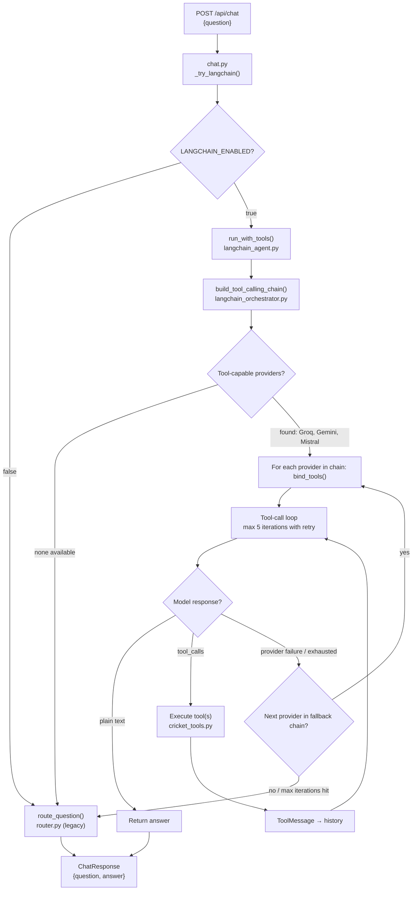
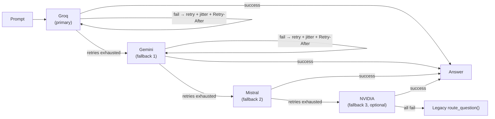

# CricketGPT — LangChain Architecture

> **Last updated:** 2026-11-17  
> **Status:** Integrated, audited, and tested (451 tests passing)

---

## Overview

CricketGPT integrates LangChain as an **optional, additive layer** on top of the existing deterministic SQL/RAG pipeline.

| Concern | Existing (always active) | LangChain layer (opt-in) |
|---|---|---|
| **Exact statistics** | SQL via `leaderboard_service`, `match_service`, etc. | Tools wrap same services |
| **RAG narrative** | `hybrid_retrieve` + pgvector | `search_cricket_knowledge` tool |
| **LLM generation** | `generate_response()` with manual fallback loop | `generate_with_langchain()` with retry + fallback chain |
| **Tool calling** | — | `run_with_tools()` agent loop with multi-provider fallback |

**Golden rule:** `LANGCHAIN_ENABLED=false` (default) → zero behaviour change. The existing `route_question()` pipeline is untouched and always works as a safety net.

---

## Architecture Diagrams

### Request Flow (with LangChain enabled)



### Retry + Fallback Chain



---

## New Files

| File | Purpose |
|---|---|
| `app/ai/llm/langchain_config.py` | Reads all `LANGCHAIN_*` env vars; returns frozen `LangChainConfig` dataclass |
| `app/ai/llm/langchain_orchestrator.py` | `build_provider_chain()`, `_invoke_with_retry()`, `generate_with_langchain()`, `get_llm_with_tools()` |
| `app/ai/tools/cricket_tools.py` | 10 `@tool`-decorated wrappers around existing services |
| `app/ai/langchain_agent.py` | Tool-call loop: `run_with_tools()` |
| `tests/ai/test_langchain_orchestrator.py` | 21 tests: config, retry, fallback, credential filtering |
| `tests/ai/tools/test_cricket_tools.py` | 27 tests: all 10 tools with mocked services |

## Modified Files

| File | Change |
|---|---|
| `app/api/routes/chat.py` | Added `_try_langchain()` pre-step (no-op when disabled) |
| `requirements.txt` | Added `langchain-core`, `langchain-groq`, `langchain-google-genai`, `langchain-mistralai` |
| `.env.example` | Added all `LANGCHAIN_*` env var documentation |

---

## Tool Catalogue

| # | Tool name | Wraps | Input schema highlights |
|---|---|---|---|
| 1 | `get_player_statistics` | `get_player_batting_stats` + `get_player_bowling_stats` | `player_name`, `season?`, `include_bowling` |
| 2 | `get_player_match_performance` | `get_match_scorecard` (filtered) | `match_id`, `player_name` |
| 3 | `compare_ipl_players` | `compare_players` | `player_one`, `player_two`, `season?` |
| 4 | `get_match_scorecard_tool` | `answer_scorecard_question` | `match_id` |
| 5 | `get_match_result_tool` | `get_match_result` | `match_id` |
| 6 | `get_player_of_the_match` | `answer_match_awards_question` | `match_id?`, `season?`, `final_only`, `limit` |
| 7 | `get_batting_leaderboard_tool` | `get_batting_leaderboard` | `category`, `season?`, `limit` |
| 8 | `get_bowling_leaderboard_tool` | `get_bowling_leaderboard` | `category`, `season?`, `limit` |
| 9 | `get_team_statistics_tool` | `get_individual_team_statistics` | `team`, `season?` |
| 10 | `search_cricket_knowledge` | `hybrid_retrieve` (pgvector + BM25) | `query`, `top_k` |

All tools are **read-only**. No INSERT/UPDATE/DELETE. Graceful error strings returned on failure — the agent loop never crashes from a tool error.

---

## Provider Compatibility

| Provider | LangChain package | Tool calling | Notes |
|---|---|---|---|
| **Groq** | `langchain-groq==1.2.0` | ✅ | Primary; fastest for most queries |
| **Gemini** | `langchain-google-genai==4.5.0` | ✅ | Fallback 1 |
| **Mistral** | `langchain-mistralai==1.2.0` | ✅ | Fallback 2 |
| **NVIDIA** | `langchain-nvidia-ai-endpoints` (optional) | ⚠️ model-dependent | Skipped if package not installed |

---

## Retry Policy

| Event | Behaviour |
|---|---|
| `TimeoutError`, `ConnectionError`, generic `RuntimeError` | Retry with exponential back-off + jitter |
| HTTP 429 rate limit | Retry (bounded) |
| HTTP 503 service unavailable | Retry |
| HTTP 401/403 authentication / `invalid api key` | **No retry** — raise immediately |
| HTTP 400 bad request | **No retry** |
| `ValueError` (bad arguments) | **No retry** |
| All retries exhausted | Try next fallback provider |
| All providers exhausted | Return `None` → legacy `route_question()` |

---

## Environment Configuration

Add these to `.env` (or Render dashboard) to enable LangChain:

```dotenv
# Enable the LangChain layer (default: false — safe no-op)
LANGCHAIN_ENABLED=true

# Tool-call loop limit (prevents infinite loops)
LANGCHAIN_MAX_TOOL_ITERATIONS=5

# Per-provider retry budget
LANGCHAIN_MAX_RETRIES=2
LANGCHAIN_RETRY_MIN_SECONDS=1
LANGCHAIN_RETRY_MAX_SECONDS=8

# Per-tool call timeout (seconds)
LANGCHAIN_TOOL_TIMEOUT_SECONDS=15

# Whether fallback providers are tried when primary fails
LANGCHAIN_FALLBACK_ENABLED=true
```

Existing vars already control provider order and credentials:

```dotenv
AI_PRIMARY_PROVIDER=groq
AI_PROVIDER_ORDER=groq,gemini,mistral,nvidia
```

---

## How to Add a New Tool

1. Add a Pydantic input schema class to `app/ai/tools/cricket_tools.py`.
2. Write the `@tool(args_schema=YourSchema)` function, calling the appropriate existing service.
3. Append your tool to `ALL_CRICKET_TOOLS`.
4. Add tests in `tests/ai/tools/test_cricket_tools.py`.

## How to Add a New Provider

1. Add credentials to `.env` / Render: `NEWPROVIDER_API_KEY`, `NEWPROVIDER_MODEL`.
2. Add a branch to `_build_llm()` in `langchain_orchestrator.py`.
3. If the provider supports tool calling, add it to `_TOOL_CALLING_PROVIDERS` in `get_llm_with_tools()`.
4. Add the provider to `AI_PROVIDER_ORDER` env var.

---

## Render Deployment Notes

To enable LangChain on the deployed Render backend, add these env vars in the Render dashboard (Environment tab):

```
LANGCHAIN_ENABLED=true
LANGCHAIN_MAX_RETRIES=2
LANGCHAIN_FALLBACK_ENABLED=true
```

The package dependencies (`langchain-groq`, `langchain-google-genai`, `langchain-mistralai`) are already in `requirements.txt` and will be installed automatically on the next deploy.

> [!IMPORTANT]
> Do **not** deploy automatically. Present this document and wait for explicit user approval before pushing or triggering a Render deploy.

